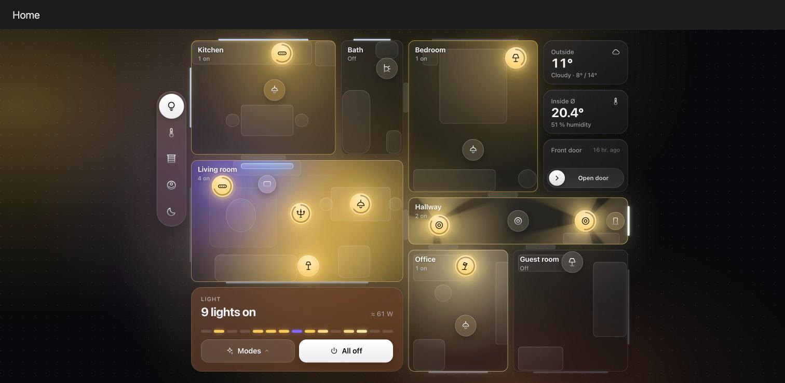
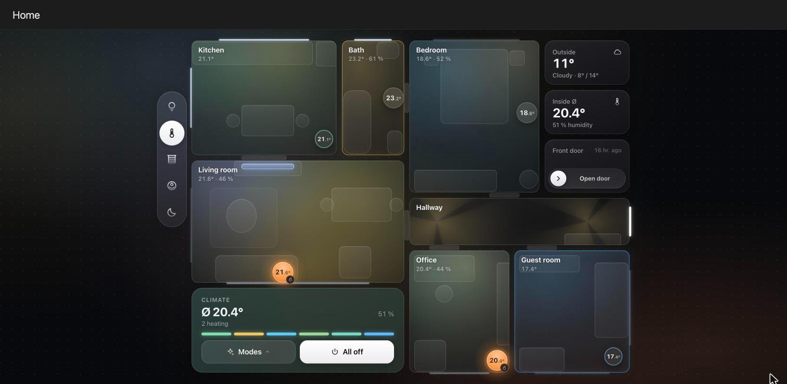
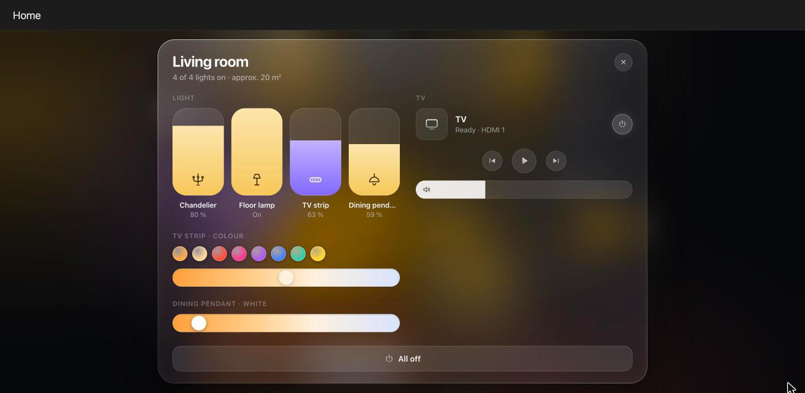
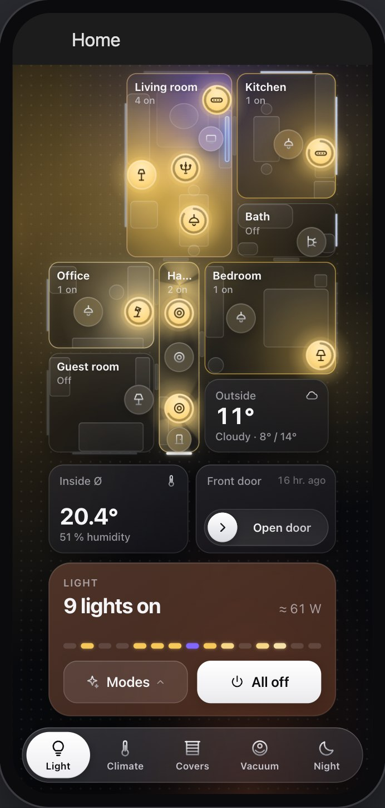
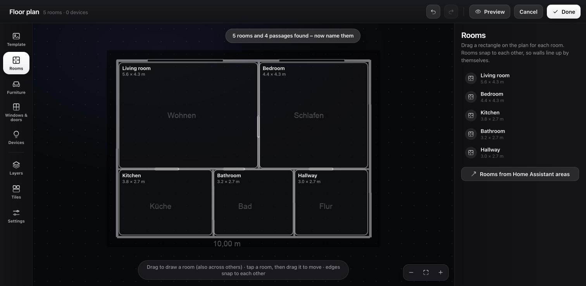

# Glass Floorplan Card

Your home as a glass floor plan for Home Assistant. Lamps glow in their real colour, rooms open as pop-ups, and layers switch between light, climate, covers, a Roborock vacuum and your own combinations. There is a phone layout as well. You draw the plan yourself in a visual editor, optionally on top of a photo or sketch of your floor plan.



| Climate layer | Room pop-up | Phone |
|---|---|---|
|  |  |  |



> Built with [Claude](https://claude.ai) (Anthropic) as a pair-programming partner. The design started as a private dashboard and was turned into this configurable card.

## Features

- **Floor plan from glass tiles.** Rooms, furniture, windows, passages and the front door are drawn in centimetres. The card scales them to fit the screen without scrolling.
- **Real light.** Lamps glow in their actual colour and brightness. Spots can have light cones, and windows let daylight in. Tap a lamp to switch it, hold it for the room.
- **Layers** (the symbols next to the plan):
  - **Light**: lights, TV/media, front door opener, modes (scenes/scripts), *All off*, power estimate
  - **Climate**: rooms are tinted by temperature, thermostats show their reading, and a dial sets the target and HVAC mode
  - **Covers**: shutters with position rings and slat tiles. Closed covers darken their window.
  - **Vacuum** (Roborock): pick rooms on the plan, choose a mode, start. The robot drives through the rooms.
  - **Own layers** combine whole categories (e.g. *Light + Covers*) with any single entities: locks, window contacts, motion sensors, switches, fans, sensors …
- **Room pop-ups** grow out of the room with spring animations. They contain dimming tiles, colour and white tone, media controls, a thermostat dial, cover tiles, device rows and helper sliders.
- **Phone layout** in the same card, switched automatically by width. A landscape plan is turned upright, the layers sit in a bar at the bottom, and pop-ups become sheets you can swipe away.
- **Visual editor** with no YAML needed:
  - Load a photo, screenshot or sketch of your floor plan, set the scale by measuring one wall, and let the editor **find the rooms and passages automatically**. You can also trace them by hand.
  - Create rooms from your **Home Assistant areas** in one click and place their devices automatically.
  - Drag furniture from a palette and click walls to add windows, passages and the front door.
  - Drag devices from a searchable list (grouped by area) onto the plan, and pick symbols, power and light cones.
  - Manage layers, undo/redo, and a live preview for laptop and phone.
- **English and German**. Numbers and times follow your Home Assistant locale.

## Try it without Home Assistant

The `demo/` folder contains a made-up flat with simulated devices, and nothing is switched for real.

```bash
python3 -m http.server 8765 --bind 127.0.0.1
# open http://127.0.0.1:8765/demo/        (?lang=de, ?scene=day|cleaning|playing|cold, ?blank=1)
#      http://127.0.0.1:8765/demo/phone.html
```

Use **Edit floor plan** in the demo sidebar to try the editor (`demo/sketch-example.png` is a sketch to practise with).

## Installation

### HACS (custom repository)

1. HACS → ⋮ → *Custom repositories* → add `https://github.com/michael-schroeter/glass-floorplan-card`, category **Dashboard**.
2. Install **Glass Floorplan Card** and reload the browser.

### Manual

Copy `dist/glass-floorplan-card.js` to `/config/www/` and add it as a resource (*Settings → Dashboards → ⋮ → Resources*): URL `/local/glass-floorplan-card.js`, type *JavaScript module*.

## Getting started

1. Create a dashboard view of type **Panel** (best) or **Sections**, then add the card *Glass Floorplan Card*. If you have areas in Home Assistant, the card starts with one room per area and their devices already placed.
2. In the card editor, click **Open floor plan editor**.
3. **Template**: load a picture of your floor plan → **Measure** (click both ends of a wall, enter its length) → **Find rooms automatically**. You can also draw rooms by dragging rectangles.
4. **Rooms**: name each room and link its Home Assistant area. The area is used by the vacuum and for placing devices.
5. **Windows & doors**, **Furniture**: optional, purely for the looks.
6. **Devices**: choose a layer and drag devices onto the plan, or use *Place automatically*.
7. **Layers**: switch built-in layers on or off, or create your own, e.g. *Night = Light + Covers + front door lock + window contacts*.
8. Click **Done**, then **Save**.

### Modes

Give scenes or scripts the label **Dashboard mode** (or `Dashboard-Modus`) in Home Assistant. They appear under *Modes* with their name and icon. A leading number (`1 Evening`) only sets the order.

### Vacuum (Roborock)

Only the vacuum entity is needed. Status, battery, current room, cleaning mode and mop intensity are found on the same device. Rooms are cleaned with `vacuum.clean_area` using the rooms' Home Assistant areas. Without areas, the card falls back to Roborock segment ids (`roborock.get_maps` + `app_segment_clean`). The robot's room names are matched to your rooms by name, or mapped in the editor. Other brands may work for start/stop, but are not targeted yet.

## Configuration (YAML)

The editor writes everything for you. For reference, all coordinates are **centimetres**, with x to the right and y downwards. Rooms are stored edge to edge, and the card draws the wall gaps itself.

```yaml
type: custom:glass-floorplan-card
language: auto            # auto | en | de
rooms:
  - id: living
    name: Living room
    area: living_room     # Home Assistant area id (vacuum, auto placement)
    rect: [0, 320, 580, 660]    # x1, y1, x2, y2
    label: bottom         # room name at the top (default) or bottom
    furniture:
      - [70, 580, 290, 652, sofa]      # x1, y1, x2, y2, kind
      - [100, 430, 180, 520, round_table]
  - id: hallway
    name: Hallway
    area: hallway
    rect: [580, 420, 1180, 560]
    helpers: [input_number.hallway_night_brightness]   # sliders in the pop-up
windows: [[100, 660, 480, 660], [0, 400, 0, 600]]     # segments on walls
doors: [[580, 460, 580, 540]]                         # passages between rooms
entrance: [1180, 450, 1180, 530]                      # front door on an outer wall
entities:
  - entity: light.living_room_ceiling
    at: [300, 470]        # position on the plan
    icon: chandelier      # glass symbol or mdi:… icon
    watt: 24              # rated power for the estimate
  - { entity: light.hallway_spot_1, at: [660, 490], icon: spot, beams: 3, kelvin: 3400 }
  - { entity: light.living_room_ceiling_2, at: [300, 470], plan: false }   # glow + tile, no button
  - { entity: media_player.living_room_tv, at: [210, 392] }
  - { entity: climate.living_room, at: [250, 630] }
  - { entity: cover.living_room_left, at: [50, 500] }
  - { entity: lock.front_door, at: [1140, 490] }
layers:
  - light
  - climate
  - cover
  - vacuum
  - name: Night
    icon: moon
    show: [light, cover]                 # whole categories: light, media, door, climate, cover
    entities: [lock.front_door, binary_sensor.living_room_window]
door: { open: button.front_door_open, doorbell: event.front_door_doorbell, at: [1140, 490] }
vacuum:
  entity: vacuum.roborock_s8
  dock: [960, 536]
  rooms: { "Wohnzimmer": living }        # optional: robot room name → room id
weather: weather.home      # default: first weather entity; false hides the tile
indoor: [sensor.kitchen_temperature]   # default: all placed climate entities; false hides the tile
modes_label: Dashboard mode
layout: auto               # auto | desktop | mobile
fit: screen                # screen (fill the visible height) | width
mobile: { rotate: auto }   # auto | 0 | 90 | -90
widgets:                   # optional fixed positions of the tiles (normally automatic)
  card: [0, 660, 580, 900]
```

| Entity option | Meaning |
|---|---|
| `at` | Position in cm. Without `at`, the entity only appears in its room's pop-up (`room:` needed). |
| `room` | Room id. By default it is the room under the marker. |
| `name`, `icon` | Override the name and symbol. Symbols include `bulb`, `ceiling`, `chandelier`, `pendant`, `lamp`, `floorlamp`, `desklamp`, `strip`, `spot`, `wall`, `sprout`, `candle`, `plug`, `fan`, `lock`, `blinds`, `thermo` …, or any `mdi:` icon. |
| `watt`, `power` | Rated power (estimate × brightness) or a power sensor |
| `kelvin`, `color` | Display colour for lamps without colour information |
| `beams` | 1–6 light cones (spots) instead of a round glow |
| `reach` | Glow radius in cm |
| `plan: false` | No button on the plan (glow and pop-up tile only) |

Furniture kinds: `sofa armchair bed bed_single table round_table chair desk wardrobe shelf sideboard tv counter fridge bath shower toilet sink washer plant rug stairs block`. A `tv` piece glows while a media player in the room is on.

## Setup with Claude

`skills/floorplan-setup/` contains a Claude skill that turns a photo of your floor plan and your entity list into a ready configuration. You then fine-tune it in the editor. See [its SKILL.md](skills/floorplan-setup/SKILL.md).

## Development

No build tools besides Python 3 are needed.

```bash
python3 tools/build.py          # src/*.js → dist/glass-floorplan-card.js (+ syntax check on macOS)
python3 tools/build.py 0.2.0    # with a version
```

| File | Content |
|---|---|
| `src/01-util.js` … `03-icons.js` | helpers, texts (en/de), glass icons |
| `src/04-model.js` | config → geometry, layers, automatic tile layout, room graph for the robot |
| `src/05-styles.js` | all styles (everything scales with `--u`) |
| `src/06-card.js` … `12-mobile.js` | card, pop-ups, climate, covers, other devices, vacuum, phone layout |
| `src/20-…25-editor*.js` | floor plan editor, room detection, card editor for Home Assistant |
| `demo/` | demo page with simulated `hass` |

## Kurz auf Deutsch

Glas-Grundriss für Home Assistant. Lampen leuchten in echter Farbe, Räume öffnen sich als Pop-ups, und es gibt Ebenen für Licht, Klima, Rollläden, Roborock-Saugroboter sowie eigene Kombinationen. Installation über HACS als benutzerdefiniertes Repository (Kategorie *Dashboard*). Danach die Karte hinzufügen und **Grundriss-Editor öffnen**: Foto oder Skizze des Grundrisses laden, ausmessen, *Räume automatisch erkennen*, Geräte auf den Plan ziehen, fertig. Modi sind Szenen und Skripte mit dem Label **Dashboard-Modus**.

## License

[MIT](LICENSE)
