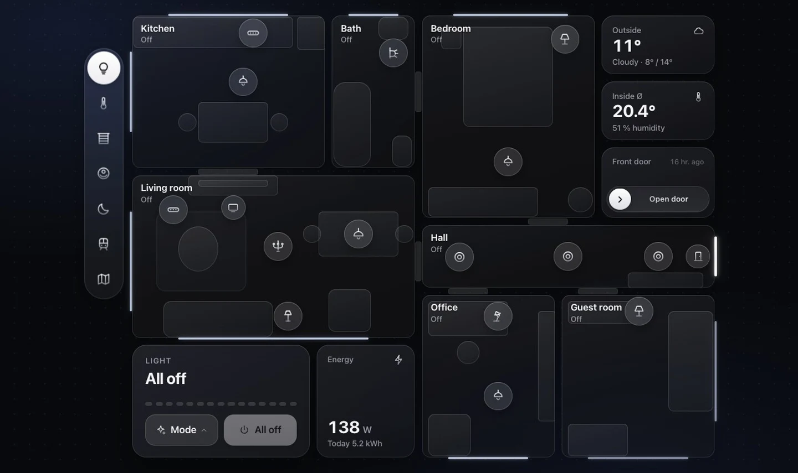
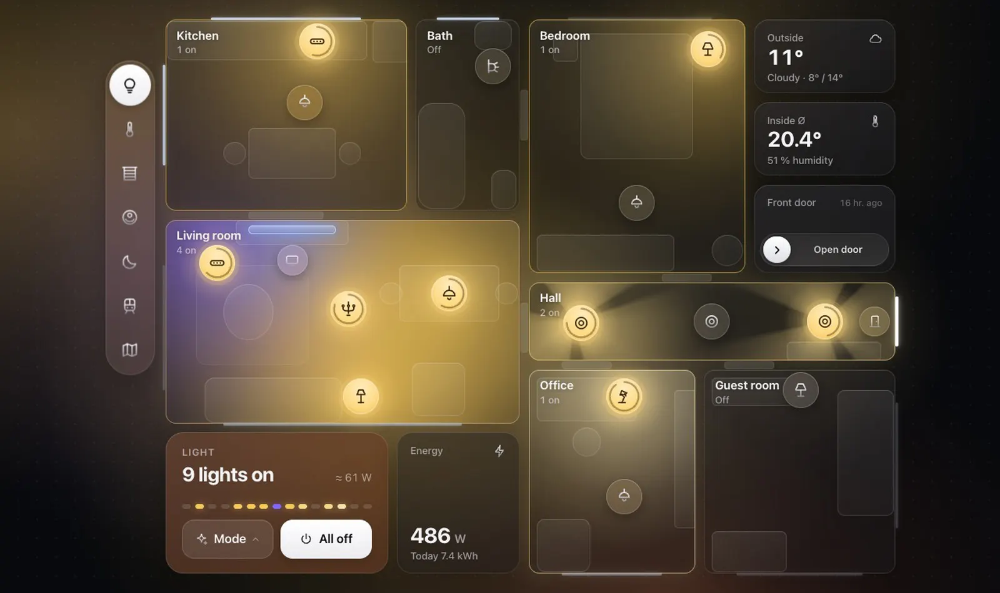
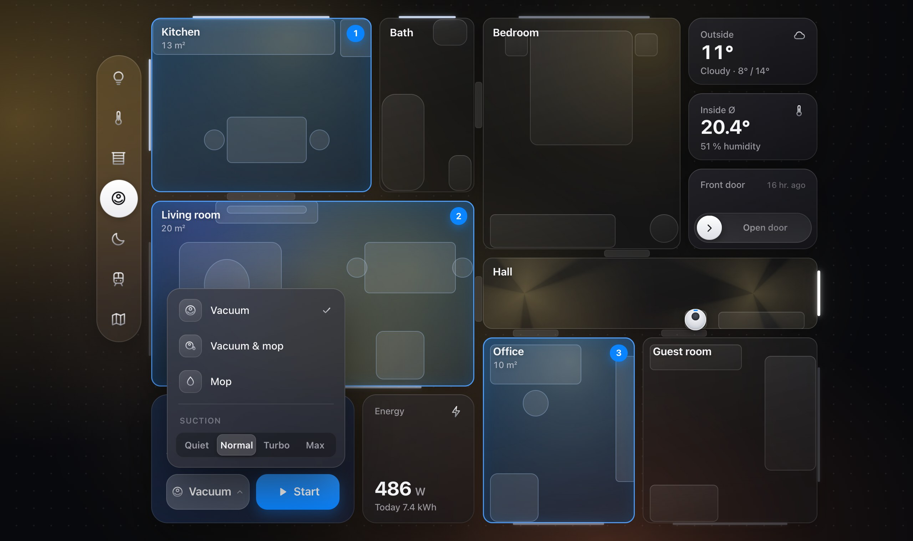
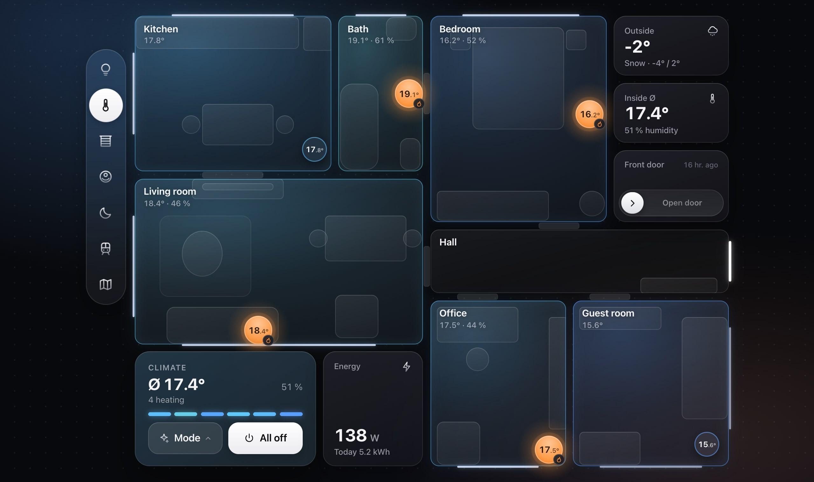
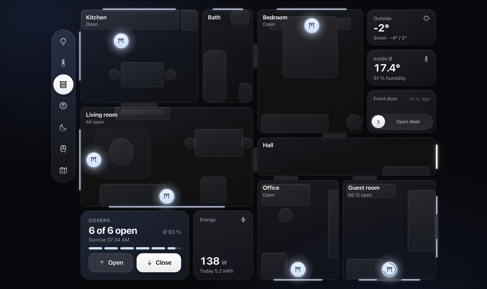
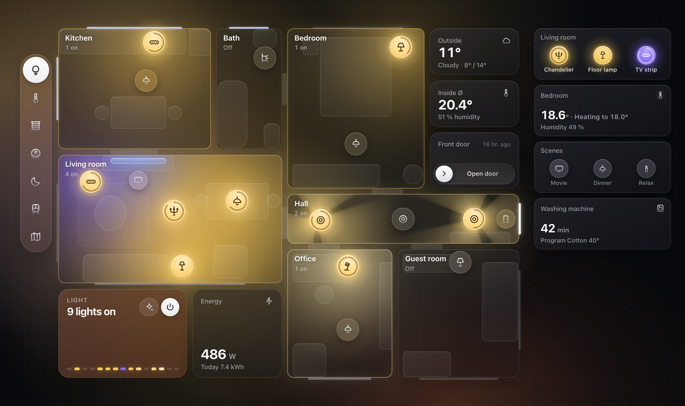
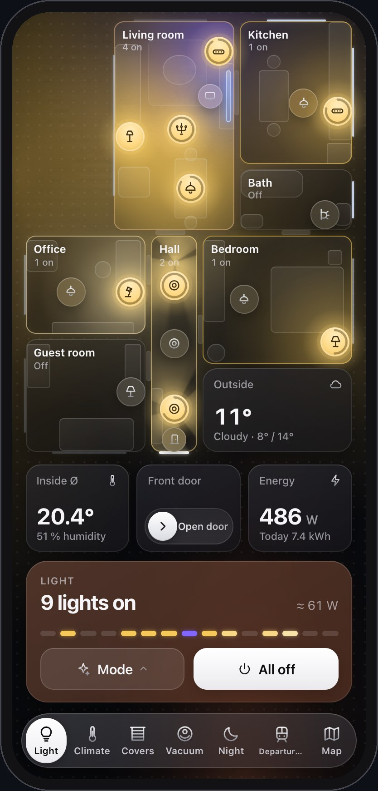
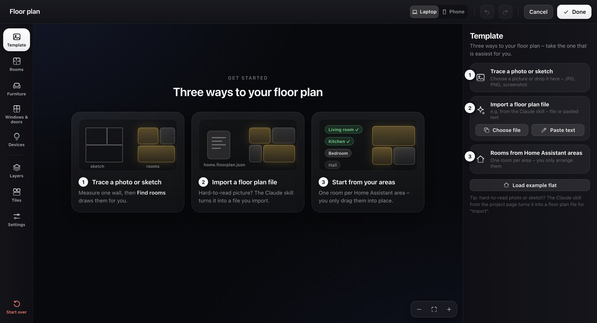
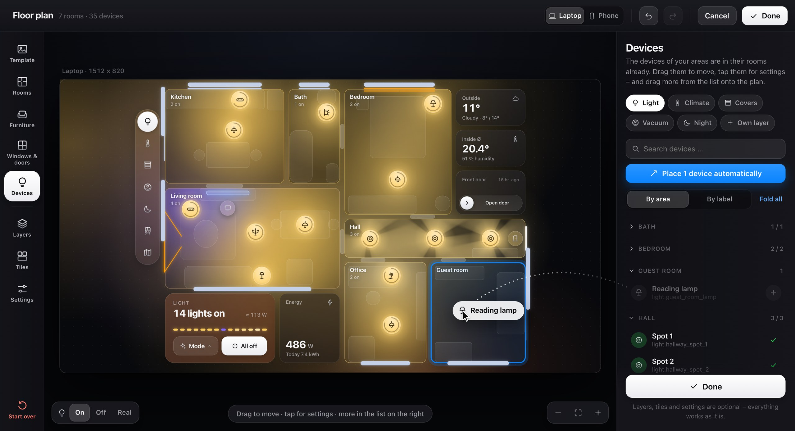
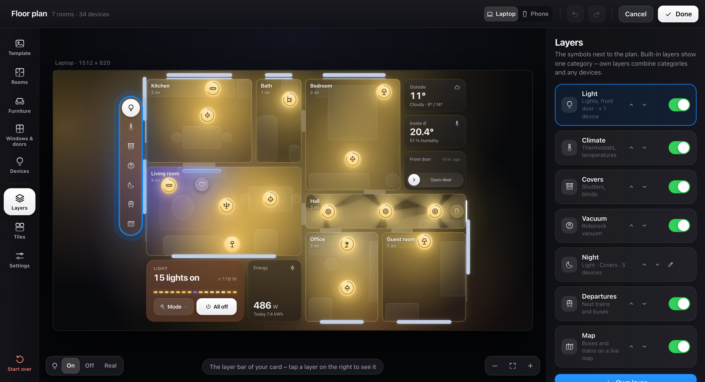

# Glass Floorplan Card

**A beautiful floor plan dashboard for Home Assistant.** 
Your home as a plan made of frosted glass, where every lamp glows in its real colour.

[**▶ Try the live demo**](https://michael-schroeter.github.io/glass-floorplan-card/) &nbsp;·&nbsp; [Install](#install) &nbsp;·&nbsp; [Configuration](docs/configuration.md)

 

 

## Tap a lamp. Tap a room.

A lamp switches with one tap and its glow fills the room – warm white, cool white or the colour of your LED strip. Tap a room and it opens as a pop-up with soft spring animations: brightness, colour, the TV, everything in that room.

## Layers

Layers switch the plan between light, climate, covers, a Roborock vacuum or your own mix, such as *Night = lights + covers + front door lock*.

Window and door contacts sit on their window: an open window glows orange and its sash swings into the room, a tilted one shows its sash slightly inside, in every layer.

Your <b>Roborock</b>: tap the rooms, choose vacuum, mop or both, press <i>Start</i>.

 

<b>Climate</b> tints every room by its temperature &nbsp;·&nbsp; <b>Covers</b> shows every blind with its position

## Make it yours

Your own tiles show **values** of your choice, **buttons** like the ones on the plan or **any Home Assistant card** in the glass look. The layer card comes in three sizes, the layer bar vertical or horizontal – and laptop and phone are arranged separately. Every device can get its own tap, hold and double tap action, the same ones as anywhere in Home Assistant.

### On your phone

The same card turns into a phone layout on its own: the plan stands upright, the layers sit in a tab bar at the bottom, and rooms open as sheets from below.

No second dashboard, no extra configuration.

 

## Your floor plan, your way

You never write coordinates. Pick whatever you have at hand:

| You have … | Do this |
|---|---|
| 📷 **A picture** of your floor plan (listing, photo, screenshot, hand sketch) | Load it in the editor, measure one wall, click **Find rooms automatically**. Rooms and doorways appear on their own. |
| ✨ **A hard-to-read picture** (taken at an angle, busy, hand-drawn) | Send it to **Claude** with the [floor plan skill](docs/claude-skill.md). You get a file back and import it with one click. |
| 🏠 **Your Home Assistant areas** | One click creates a room for each area. Drag them where they are – the devices follow by themselves. |
| ✏️ **Nothing but your memory** | Drag rectangles. Edges snap together, so the rooms line up like walls. |

Three ways to start: trace a picture, import a file, or begin with your areas.

 

<b>Devices</b> are dragged from the list onto the plan &nbsp;·&nbsp; <b>Layers</b> are switched on, sorted or made your own

Rooms named like a Home Assistant area are linked by themselves (also across languages, *Living* ↔ *Wohnzimmer*) and take its name; drag any other area onto its room. **Next** takes you through furniture (one click for typical pieces), windows and doors to your devices, which are in their rooms already. Click **Done**. The editor always shows the real card at the real size of your screen.

## Simple by default, deep if you want

**Out of the box** link your rooms to Home Assistant areas and the rest falls into place: devices land in their rooms, lamps get the right symbol, and layers for light, climate, covers and your Roborock appear on their own.

**If you like**, you can fine-tune a lot: furniture, windows and the front door, symbols for each device, light cones for spots, a door opener and doorbell, modes from your scenes and scripts, your own layers and tiles. All of it is in the editor. YAML is there if you want it, but you never need it.

## Install

Or in HACS: ⋮ → *Custom repositories* → `https://github.com/michael-schroeter/glass-floorplan-card`, category **Dashboard**. Install **Glass Floorplan Card** and reload the browser.

Then add the card to a dashboard view of type **Panel** (best) or **Sections**, and click **Open floor plan editor**.

Manual installation

Copy `glass-floorplan-card.js` from the [latest release](https://github.com/michael-schroeter/glass-floorplan-card/releases/latest) to `/config/www/` and add it under *Settings → Dashboards → ⋮ → Resources* as `/local/glass-floorplan-card.js` (*JavaScript module*).

## More

- [Configuration reference](docs/configuration.md): all options, modes, vacuum, YAML
- [Floor plan from a picture with Claude](docs/claude-skill.md)
- [Development](docs/development.md): build, local demo, file overview

English and German.

---

Built with Claude. It started as a private dashboard and became this card. All pictures show the made-up demo flat with simulated devices. · [MIT License](LICENSE)
